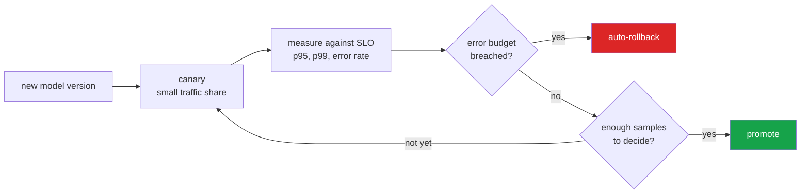

# model-serving-platform

[](https://github.com/hammasbuilds/model-serving-platform/actions/workflows/ci.yml)

We built model-serving-platform as the deployment logic for serving several model versions at once:
a registry with one enforced champion, sticky A/B and canary splits, shadow traffic, per-version SLOs
and automatic rollback of a breaching canary. It is an in-process Python library with no dependencies
(there is no HTTP endpoint or CLI): you call `ServingPlatform.predict()` from your own process or wrap
it in your own web handler, and any Python callable can be a model. It is for ML engineers who want
canary and rollback behaviour they can test in milliseconds.

A full web UI for this lives in [LLM Control Room](https://github.com/hammasbuilds/llm-control-room)
(Releases page).

## What it does



- **Registry:** versions with lifecycle stages; at most one champion per model, and promotion demotes
  the old champion in the same operation.
- **Canary:** a share of traffic goes to a challenger. Assignment is a salted hash of the request key,
  so a user always lands on the same version and a split can be replayed exactly.
- **Shadow:** a version scores real traffic while its output is discarded; its exceptions never reach
  the caller.
- **SLOs:** per-version p50/p95/p99 (nearest-rank) and error rate, compared champion against challenger,
  with no verdict below a sample floor.
- **Auto-rollback:** a breaching canary removes itself, unless the champion is breaching too (a shared
  upstream outage), in which case nothing is rolled back. Promotion stays manual.

## Sample input / output

`python demo.py`:

```text
INPUT
   champion v1 and challenger v2, 50/50 canary split, SLO max_error_rate=2%
   scenario A  challenger broken, champion healthy
   scenario B  shared upstream down, both broken
   2000 requests sent through each

OUTPUT
   scenario A  challenger broken, champion healthy
      champion now       v1
      rollbacks fired    1
      reason             error rate 100.00% exceeds 2.00%

   scenario B  shared upstream down, both broken
      champion now       v1
      rollbacks fired    0
      held               both versions breach; rolling back would
                         remove a deployment that is no better or worse
```

The challenger fails 100% of requests in both scenarios; the decisions are opposite because only in
scenario A is the champion a way out.

## Results

- Scenario A above: one rollback, fired on a 100.00% error rate against a 2.00% SLO. Scenario B: zero
  rollbacks, the canary is held because the champion is equally broken.
- 44 tests (fake models that return, fail or stall on demand) cover the registry, splitting
  (stickiness, distribution, salt decorrelation), serving, shadow containment, SLOs and rollback. Every
  `python` block in this README is run by the test suite.

The shared-outage case as code (it runs as written):

```python
from serving import SLO, ServingPlatform, SLOMonitor

def broken(features):
    raise RuntimeError("upstream feature store timeout")

p = ServingPlatform(monitor=SLOMonitor(slo=SLO(max_error_rate=0.05, min_samples=20)))
for v in (1, 2):
    p.registry.register("risk", v)
    p.load("risk", v, broken)          # both versions fail: a shared outage
p.registry.promote("risk", 1)
p.registry.start_canary("risk", 2, 0.5)
for i in range(300):
    try:
        p.predict("risk", {}, request_key=f"u{i}")
    except RuntimeError:
        pass                           # a failing model is recorded, then re-raised

assert p.registry.challenger("risk") is not None   # canary still running
assert not p.rollbacks                             # nothing was rolled back
```

## Tech stack

- Python 3.12, standard library only (`hashlib` for sticky assignment)
- Dev: pytest, ruff, uv (also installable with `pip install -e ".[dev]"`)

## Run it

```bash
git clone https://github.com/hammasbuilds/model-serving-platform
cd model-serving-platform
uv sync --all-groups        # or: pip install -e ".[dev]"
uv run python demo.py
uv run pytest -q
```

Models are callables, so anything works: an sklearn `.predict`, a torch module, an HTTP client.

```python
from serving import ServingPlatform

def champion_model(features):
    return 0.10

def new_model(features):
    return 0.12

def shadow_model(features):
    return 0.11

platform = ServingPlatform()
for version, model in ((1, champion_model), (2, new_model), (3, shadow_model)):
    platform.registry.register("risk", version)
    platform.load("risk", version, model)

platform.registry.promote("risk", 1)             # v1 serves everything
platform.registry.start_canary("risk", 2, 0.05)  # 5% to v2, sticky per user
platform.registry.add_shadow("risk", 3)          # v3 scores, nobody sees it

result = platform.predict("risk", {"income": 52_000, "age": 41}, request_key="user-42")
print(result.version)           # 1 or 2, stable for this user
print(result.shadow)            # v3's output and whether it agreed
print(platform.status("risk"))  # champion vs challenger, side by side
print(platform.rollbacks)       # why anything was rolled back
```

Sticky assignment on its own:

```python
from serving.routing.split import in_canary

assert in_canary("user-42", 0.05) == in_canary("user-42", 0.05)   # same user, same answer
share = sum(in_canary(f"u{i}", 0.05) for i in range(20_000)) / 20_000
assert 0.04 < share < 0.06                                         # about 5% of users
```

State lives in the process; running several instances needs a shared registry and SLO window.

## Licence

MIT, see [LICENSE](LICENSE).
